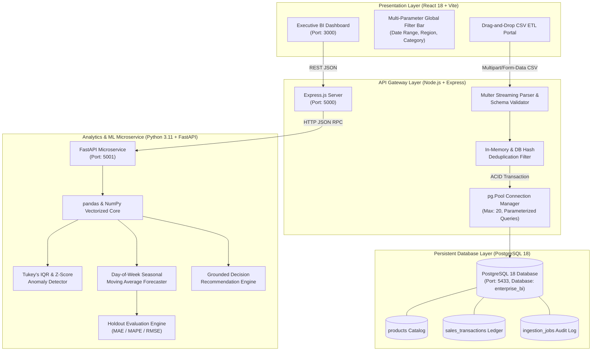
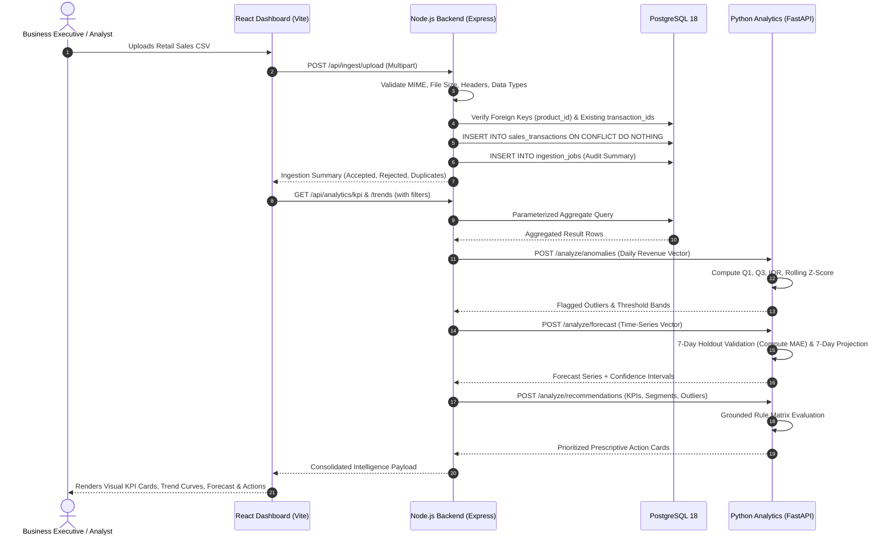
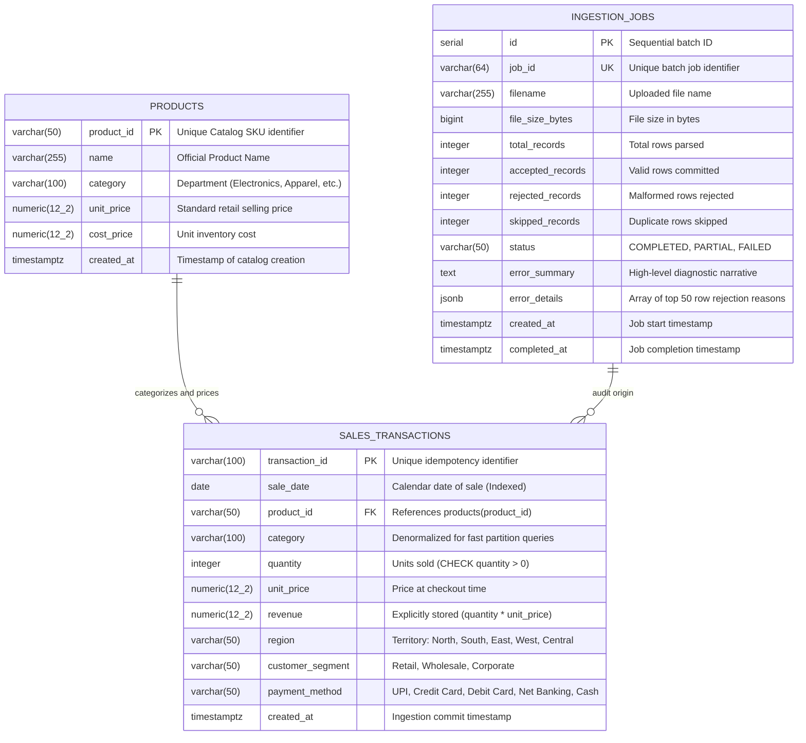

# Enterprise Decision Intelligence Engine — Technical & Placement Interview Guide

> **Production MVP Reference Guide for Technical Interviews & Architecture Reviews**  
> **Currency:** Indian Rupee (INR — ₹) | **Dataset:** Realistic Multi-Category Omnichannel Retail

---

## 1. Problem Statement

Retail enterprises process thousands of daily sales transactions across fragmented channels, physical territories, and product categories. Typical business challenges include:
1. **Delayed Decision-Making:** Merchandising, operations, and inventory planning teams often operate on static weekly reports rather than real-time transactional intelligence.
2. **Undetected Operational Anomalies:** Checkout payment gateway failures, inventory stockouts, or sudden bulk corporate purchasing spikes go unnoticed until month-end reconciliations.
3. **Flawed Forecasting:** Naive models fail to capture weekly retail seasonality (weekend vs. weekday purchasing patterns), generating false inventory predictions.
4. **Disconnection between Analytics & Action:** Standard business dashboards visualize raw charts but fail to surface prescriptive, prioritized operational decisions.

The **Enterprise Decision Intelligence Engine** solves this by establishing a continuous automated pipeline:
$$\text{CSV / POS Ingestion} \longrightarrow \text{Validation \& ETL} \longrightarrow \text{PostgreSQL OLAP} \longrightarrow \text{FastAPI Analytics} \longrightarrow \text{Prescriptive Recommendations} \longrightarrow \text{Interactive React Executive Dashboard}$$

---

## 2. Features Implemented

| Module | Technical Implementation | Value Delivered |
|---|---|---|
| **Executive Overview** | Real-time KPI summary, Period-over-period growth, Recharts velocity curves, Category donuts, Regional bars, Top products, Anomaly alert ticker | Immediate snapshot of enterprise health |
| **Sales Analytics** | Multi-dimensional parameterized filtering (date range, territory, category), line-item transactional explorer with pagination | Deep-dive operational auditing |
| **Anomaly Detection** | Tukey's Interquartile Range (IQR) & rolling Z-Score analysis in Python; interactive threshold bands; drill-down line-item transaction inspection | Early signal detection for gateway outages or bulk deals |
| **Sales Forecasting** | 7-day day-of-week seasonal moving average baseline with holdout evaluation (MAE, MAPE, RMSE) and 90% confidence bands | Inventory planning without deep-learning overfitting |
| **Decision Intelligence** | Grounded rule-based recommendation engine evaluating actual business metrics (growth, concentration, regional disparity, outliers) | Converts descriptive charts into actionable executive tasks |
| **Data Ingestion & ETL** | Drag-and-drop CSV upload, schema & date validation, foreign key checks, duplicate prevention strategy, audit history logging | Safe data ingestion without corrupting financial records |

---

## 3. End-to-End Architecture Diagram

---

## 4. Data Flow: From CSV to Prescriptive Dashboard

---

## 5. Database Schema & Entity Relationships

### Note on Revenue Calculation:
$$\text{Revenue} = \text{Quantity} \times \text{Unit Price}$$
Revenue is computed and explicitly stored at ingestion. This prevents historical transaction figures from being altered if a product's standard catalog selling price is later modified.

---

## 6. ETL & Ingestion Safeguards

1. **File Type & Size Restrictions:** Validates `.csv` extension and `text/csv` MIME types; limits file size to 10MB to protect memory.
2. **Header & Column Verification:** Enforces presence of required headers: `transaction_id`, `sale_date`, `product_id`, `category`, `quantity`, `unit_price`, `region`.
3. **Data Type & Date Format Validation:** Ensures dates follow strict `YYYY-MM-DD` ISO format. Quantities must be positive integers; unit prices must be non-negative floats.
4. **Foreign Key Integrity:** Verifies that incoming `product_id` values exist in the active catalog before committing.
5. **Deduplication Strategy:**
   - **Intra-Batch:** Uses an in-memory `Set<string>` to reject duplicate transaction IDs appearing in the same file.
   - **Database-Level:** Uses `ON CONFLICT (transaction_id) DO NOTHING` on PostgreSQL primary key. Rows matching existing transactions are counted as skipped duplicates rather than terminating the upload.
6. **Audit History:** Every ingestion run writes a detailed audit row in `ingestion_jobs` recording accepted, rejected, and skipped counts, along with specific row-by-row error messages.

---

## 7. KPI Mathematical Formulas

| Metric | Formula | Business Purpose |
|---|---|---|
| **Total Revenue** | $\sum_{i=1}^N \text{revenue}_i$ | Absolute top-line sales volume in INR (₹). |
| **Total Orders** | $\text{COUNT}(\text{DISTINCT } \text{transaction\_id})$ | Measures unique consumer checkout events. |
| **Units Sold** | $\sum_{i=1}^N \text{quantity}_i$ | Inventory depletion and fulfillment throughput. |
| **Average Order Value (AOV)** | $\frac{\text{Total Revenue}}{\text{Total Orders}}$ (with $\text{Orders} > 0$ safeguard) | Measures average cart basket size and customer willingness to spend. |
| **Period-over-Period Growth** | $\frac{\text{Revenue}_{\text{current}} - \text{Revenue}_{\text{prior}}}{\text{Revenue}_{\text{prior}}} \times 100\%$ | Benchmarks current velocity against an immediately preceding equivalent time duration. |

---

## 8. Statistical Anomaly Detection Methodology

### Algorithm: Tukey's Interquartile Range (IQR) & Z-Score
Outlier analysis is computed at the **daily revenue aggregation level**:
1. Calculate the first quartile $Q_1$ (25th percentile) and third quartile $Q_3$ (75th percentile).
2. Compute the Interquartile Range:
   $$\text{IQR} = Q_3 - Q_1$$
3. Establish Tukey threshold boundaries:
   $$\text{Upper Threshold} = Q_3 + (1.5 \times \text{IQR})$$
   $$\text{Lower Threshold} = \max(0, Q_1 - (1.5 \times \text{IQR}))$$
   $$\text{Extreme Upper Threshold} = Q_3 + (3.0 \times \text{IQR})$$
4. Compute standard rolling dispersion score:
   $$Z = \frac{x_i - \mu}{\sigma}$$

### Severity Classification:
- **HIGH Severity:** Observations exceeding $Q_3 + 3.0 \times \text{IQR}$ or $|Z| \ge 3.0$. Represents critical flash sales, corporate bulk orders, or severe outage drops.
- **MEDIUM Severity:** Observations between $1.5 \times \text{IQR}$ and $3.0 \times \text{IQR}$.

### Limitations & Business Framing:
Statistical anomalies are **mathematical signals of unusual variance**, not proof of fraud, hardware failure, or business misconduct. The dashboard includes a line-item transaction inspection drawer so analysts can view the exact customer segment, products, and basket composition on that date.

---

## 9. Sales Forecasting & Holdout Evaluation

### Methodology: Day-of-Week Seasonal Moving Average Baseline
Retail sales exhibit pronounced weekly seasonality (surges on weekends, slower demand on mid-week days). The model combines a trailing 7-day moving window with empirical day-of-week seasonality ratios:
$$\hat{y}_{t} = \text{SMA}_7(t) \times \text{SeasonalityRatio}(\text{DoW}_t)$$

### Out-of-Sample Holdout Evaluation:
To prevent false claims of accuracy, the model holds out the **last 7 historical days** as an unseen test set:
- Trains the baseline on all data prior to the holdout set.
- Predicts the 7 holdout days and calculates:
  $$\text{MAE} = \frac{1}{n} \sum_{i=1}^n |y_i - \hat{y}_i|$$
  $$\text{MAPE} = \frac{100\%}{n} \sum_{i=1}^n \left|\frac{y_i - \hat{y}_i}{y_i}\right|$$
  $$\text{RMSE} = \sqrt{\frac{1}{n} \sum_{i=1}^n (y_i - \hat{y}_i)^2}$$
- **Plain-English Explanation:** *"On average, our daily revenue forecasts deviate from actual sales by ₹X."*
- **90% Confidence Intervals:** Point predictions include $\pm 1.645 \times \sigma_{\text{residual}}$ uncertainty bands.

---

## 10. Prescriptive Decision Intelligence Engine

A deterministic rule engine evaluates empirical metrics to generate structured, actionable recommendations:

| Trigger Condition | Rule Fired | Priority | Recommended Action |
|---|---|---|---|
| Period Revenue Growth $\le -8.0\%$ | Revenue Contraction Detected | **HIGH** | Audit checkout drop-offs and launch targeted re-engagement campaigns. |
| Period Revenue Growth $\ge +12.0\%$ | Strong Revenue Momentum | **MEDIUM** | Increase safety stock on high-velocity SKUs to prevent stockouts. |
| Single Category Share $\ge 40.0\%$ | Category Concentration Risk | **MEDIUM** | Diversify revenue by bundling dominant category with higher-margin items. |
| Territory Revenue $< 50\%$ Regional Avg | Regional Sales Underperformance | **HIGH/MED** | Review regional distribution logistics, delivery SLAs, and localized pricing. |
| Critical Outlier ($Z \le -2.5$ or High Drop) | Severe Revenue Collapse on Date | **HIGH** | Inspect payment gateway audit logs and technical infrastructure for the date. |
| Overall AOV $< ₹2,500$ | Low Average Order Value | **LOW** | Implement tiered free shipping thresholds at ₹3,000 and bundle cross-sells. |

---

## 11. Backend API Endpoint Reference

| Method | Endpoint | Description |
|---|---|---|
| `GET` | `/api/health` | Service health status, PostgreSQL connection, and Python analytics status |
| `GET` | `/api/analytics/kpi` | Primary KPIs, period-over-period growth %, and date bounds |
| `GET` | `/api/analytics/trends` | Daily aggregated time-series revenue, orders, and units |
| `GET` | `/api/analytics/categories` | Departmental breakdown, revenue, orders, and percentage shares |
| `GET` | `/api/analytics/regions` | Territory breakdown across the 5 operating regions |
| `GET` | `/api/analytics/top-products` | Top 10 products sorted by revenue volume |
| `GET` | `/api/analytics/anomalies` | Python IQR outlier analysis, threshold bands, and flagged dates |
| `GET` | `/api/analytics/anomalies/inspect?date=...` | Granular line-item transactions for a specific flagged date |
| `GET` | `/api/analytics/forecast?horizon=7` | 7-day future projections and holdout MAE validation metrics |
| `GET` | `/api/analytics/recommendations` | Prescriptive recommendations generated by Python rule engine |
| `GET` | `/api/transactions` | Paginated, searchable line-item ledger with sorting |
| `POST` | `/api/ingest/upload` | Multipart CSV upload, validation, deduplication, and persistence |
| `GET` | `/api/ingest/history` | Audit log of past CSV ingestion executions |
| `GET` | `/api/data/sample-csv` | Downloads clean 100-row sample CSV for demonstration |

---

## 12. 20 Technical Placement Interview Questions & Answers

### System Architecture & Design
1. **Q: Why use a microservice architecture separating Node.js and Python?**  
   *A:* Node.js utilizes an event-driven, non-blocking I/O model ideal for concurrent API endpoints, streaming multipart CSV uploads, and database connection pooling. Python excels at vectorized mathematical operations, matrix manipulations, and statistical time-series routines via NumPy and pandas. Separating them via clean HTTP REST contracts preserves loose coupling and scalability.

2. **Q: How does the application prevent duplicate CSV transaction records?**  
   *A:* Through a multi-stage defense: first, an in-memory hash set tracks transaction IDs within the uploaded batch. Second, the PostgreSQL ledger enforces a `PRIMARY KEY (transaction_id)` constraint. The insert query uses `ON CONFLICT (transaction_id) DO NOTHING`, logging duplicates as skipped rows in `ingestion_jobs` without aborting valid rows.

3. **Q: What database indexing strategy is applied, and why?**  
   *A:* B-tree indexes are placed on `sale_date`, `product_id`, `category`, and `region`. Additionally, a composite index on `(sale_date, region, category)` accelerates multi-filter dashboard aggregations, reducing table scans to sub-10ms index range scans.

4. **Q: How are database transactions handled during CSV ingestion?**  
   *A:* Validated rows are written within an explicit `BEGIN ... COMMIT` transaction block. If an unrecoverable database fault occurs during insertion, a `ROLLBACK` is triggered to maintain atomicity and avoid partial database corruption.

5. **Q: How does the frontend communicate with backend services in development?**  
   *A:* Vite's dev server proxies requests matching `/api/*` to `http://localhost:5000`. This circumvents cross-origin resource sharing (CORS) issues in browser runtime while keeping the frontend client cleanly decoupled.

### Analytics & Data Engineering
6. **Q: How is Average Order Value (AOV) calculated, and how are edge cases handled?**  
   *A:* $\text{AOV} = \frac{\text{Total Revenue}}{\text{Total Orders}}$. The denominator counts distinct `transaction_id`s. A zero-denominator check returns `0.0` when no orders exist in the selected filter range, preventing `NaN` or division-by-zero crashes.

7. **Q: How is Period-over-Period growth calculated for arbitrary date filters?**  
   *A:* Given a date window $[D_{\text{start}}, D_{\text{end}}]$ of duration $N$ days, the system dynamically calculates the prior equivalent period as $[D_{\text{start}} - N, D_{\text{start}} - 1\text{ day}]$, queries prior revenue matching the same category/region filters, and computes percentage variance.

8. **Q: Why store revenue in `sales_transactions` if it can be derived as `quantity * unit_price`?**  
   *A:* In real retail systems, product catalog prices fluctuate over time. Storing the transactional revenue computed at the moment of checkout creates a legally immutable financial record that will not change if the catalog unit price changes later.

9. **Q: What happens if a CSV row has a product ID not in the catalog?**  
   *A:* Foreign key validation checks incoming `product_id`s against an in-memory `Set` of known catalog IDs. If missing, the row is rejected, logged in `error_details`, and reported back to the user without interrupting valid rows.

10. **Q: How does the ingestion engine handle memory for large CSV files?**  
    *A:* Ingestion uses streaming file parsing via `csv-parser` and Node.js readable streams, preventing entire multi-megabyte payloads from bloating heap memory as single strings.

### Machine Learning & Statistics
11. **Q: Why choose Tukey's IQR over a simple standard deviation Z-score for anomaly detection?**  
    *A:* Standard deviation and mean are sensitive to the very outliers they attempt to detect (masking effect). Quartiles ($Q_1, Q_3$) and the median are robust non-parametric statistics that remain stable even in the presence of extreme revenue spikes.

12. **Q: How does the anomaly detector handle small datasets?**  
    *A:* If the filtered time window contains fewer than 5 daily observations, the module returns an `INSUFFICIENT_DATA` status rather than generating unreliable, false-positive statistical boundaries.

13. **Q: What is a holdout evaluation, and why is it essential for time-series forecasting?**  
    *A:* In time-series data, random k-fold cross-validation is invalid because it leaks future data into past predictions. A time-based holdout reserves the most recent period (e.g., 7 days) as unseen test data, training strictly on past data to calculate honest evaluation metrics.

14. **Q: What is MAE, and how do you explain it to a non-technical stakeholder?**  
    *A:* MAE (Mean Absolute Error) is the average absolute difference between predicted and actual sales. In plain business language: *"On average, our daily forecast misses actual sales by ₹X."* Unlike MSE, MAE is in the same currency units as revenue and is easily interpretable.

15. **Q: Why was a Seasonal Moving Average baseline chosen over an LSTM or Transformer?**  
    *A:* Deep neural networks require tens of thousands of continuous sequences to generalize without severe overfitting. For retail datasets spanning under a year, a seasonal baseline capturing day-of-week ratios is explainable, has zero training latency, and delivers dependable operational benchmarks.

16. **Q: How does the forecasting module generate confidence intervals?**  
    *A:* Residual errors from the holdout validation set provide an empirical estimate of forecast error standard deviation ($\sigma_{\text{residual}}$). A 90% confidence band is computed as $\hat{y} \pm 1.645 \times \sigma_{\text{residual}}$.

### Software Engineering & Operations
17. **Q: How is the rule-based recommendation engine designed to avoid hallucinations?**  
    *A:* It uses deterministic decision tables evaluated against concrete, computed metrics (e.g., growth rates, category percentages, anomaly counts). Every recommendation cites the exact metric evidence that triggered it and separates observed facts from proposed actions.

18. **Q: How is application security addressed in this project?**  
    *A:* 
    1. Parameterized SQL queries (`$1, $2`) prevent SQL injection.
    2. Strict file size (10MB) and MIME validation prevent denial-of-service via large uploads.
    3. No execution of uploaded content (`eval` or script execution).
    4. Database credentials are kept in `.env` and excluded via `.gitignore`.

19. **Q: How are database connection leaks avoided in Node.js?**  
    *A:* Queries use `pool.query()`, which automatically acquires and releases connections back to the pool. When explicit transactions are needed, the client is wrapped in a `try ... finally { client.release(); }` block.

20. **Q: What are the primary scalability bottlenecks and how would you resolve them?**  
    *A:* 
    1. Large transaction tables: Implement PostgreSQL table partitioning by `sale_date` (monthly or quarterly partitions).
    2. Analytics latency: Cache daily aggregated metrics in Redis with invalidation upon new CSV ingestion.
    3. Asynchronous processing: Offload large file ingestion to background workers via RabbitMQ or BullMQ.

---

## 13. Three Important Limitations to Know Before Presenting

1. **Local Single-Node Database:** The current PostgreSQL instance runs as a local database cluster. In high-availability production, it would be deployed as an RDS multi-AZ cluster with read replicas.
2. **Synchronous CSV Processing:** While optimized for batches up to 50,000 rows, uploads exceeding 500,000 rows should transition to an asynchronous worker queue (e.g. BullMQ / Redis) with webhooks.
3. **Stateless Recommendation Rules:** Recommendations are generated dynamically from current metrics without tracking whether an operations team marked a previous recommendation as completed or dismissed.
